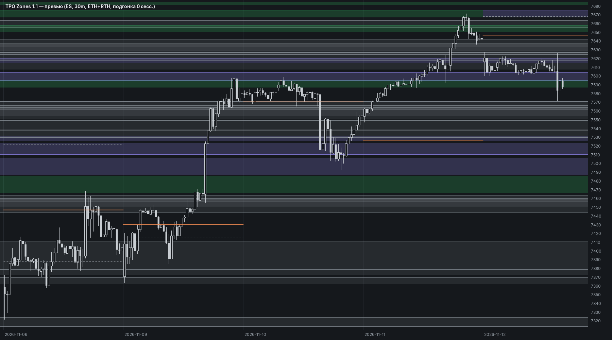

# TPO Zones 1.1 — индикатор для MotiveWave 7

Карта зон из ветки `Zones-1.1` прямо на графике MotiveWave: то же, что страница
`scripts/zone_map_template.html`, но считается из баров инструмента в самой платформе.



## Установка

1. Взять `dist/TpoZones-1.1.jar`.
2. В MotiveWave: **Import Studies/Strategies…** → выбрать jar.
3. На графике ES: меню исследований → **Patterns → TPO Zones 1.1**.

График может быть любого таймфрейма. Индикатор сам запрашивает 30m-серию
(настройка «Бары профиля», не менять) и рисует зоны по времени. Для профилей нужна
длинная история: по умолчанию просит 1500 календарных дней («Загружать историю»).
Сколько придёт на самом деле, зависит от поставщика данных.

## Что рисуется

| Цвет | Зона |
|---|---|
| зелёный | HVN · поддержка (≥ 60% отторжений хвостом вверх) |
| красный | HVN · сопротивление (≥ 60% отторжений вниз) |
| фиолетовый | HVN · проторговка |
| серый | HVN без истории; серые зоны (композит 2 дня, слабый HVN 5–7 TPO, молодая первородная) |
| синий | старый баланс — VA композита ≥ 3 дней (по умолчанию выключен, как на странице) |
| пунктир / оранжевая | VAH, VAL / POC вчерашнего RTH-профиля на каждую сессию |

Подсказка при наведении на зону: тип, границы, дата появления, возраст, отторжения
(лонг / шорт, чистота), подтверждения, источник серой зоны, подгонка.

Логика и фильтры по умолчанию — как на странице карты зон: 6 ближайших к open сессии
зон (зона, попавшая в шестёрку хоть в одну сессию, рисуется весь свой срок),
без подгонки границ, серая скрывается, если на > 30% заходит на основную. Подгонка по
телам свечей (N сессий) и перевод серых в основные — во вкладке «Карта зон». Все пороги
из `config.yaml` — во вкладке «Расчёт». Фильтра «тестов» со страницы нет.

Зоны пересчитываются раз в сессию: при первом баре новой сессии.

## Отличия от Python-версии

- **Back-adjust.** Python склеивает роллы ES (`tpo/rolls.py`). MotiveWave считает по тем
  ценам, что на графике: на несклеенном непрерывном контракте зоны старше последнего ролла
  сдвинуты на спред (~50–75 п.). Лучше брать склеенный (back-adjusted) ряд, если поставщик данных его даёт.
- **RTH-дни** берутся из 30m-баров 08:30–15:00 CT той же серии. Полный день — 13 периодов, короткие
  (праздники) в профили и композиты не идут, как в Python.

## Проверка против Python

`ZoneEngine.java` — порт `scripts/zone_map_export.py` и фильтров страницы, `ZonePlan.java` —
раскладка в прямоугольники, `TpoZonesStudy.java` — только настройки и фигуры SDK.

```bash
motivewave/parity/run.sh     # из корня; нужны python + requirements.txt, JDK 21+, node
```

Скрипт строит эталон Python (`zone_map_export`), прогоняет Java на тех же back-adjusted барах
и настоящий JS страницы в node. На данных до 2026-11-12, при подгонке 0 / 3 / 10 / 20 / 60 сессий:

- все 206 зон эталона — те же границы, даты, отторжения, подтверждения, «серость», подогнанные границы;
- видимость и вид зон совпадают во всех сессиях, кроме 1–3 последних. В них у Java есть RTH-дни
  10–11.11 из ETH-выгрузки, которых нет в `ES_30m_RTH.csv` (он кончается 09.11), — у пары зон
  от этого больше отторжений и другой класс.

## Сборка

```bash
JAVAC=/путь/к/jdk-24+/bin/javac MW_SDK=/путь/к/mwave_sdk.jar motivewave/build.sh
```

SDK MotiveWave 7 (`mwave_sdk.jar`, сборка 2025-09-19) скомпилирован под Java 24, поэтому нужен
javac 24+. Байткод индикатора — Java 21. SDK в репозиторий не кладётся (`lib/` в `.gitignore`).
