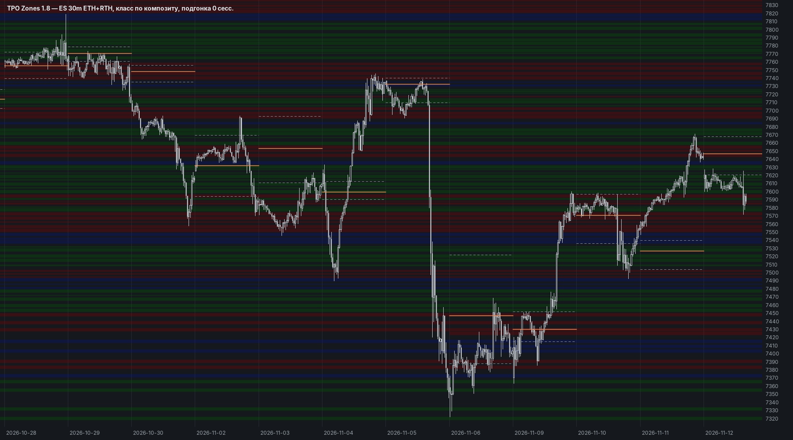

# TPO Zones 1.5 — индикатор для MotiveWave 7

Карта зон из ветки `Zones-1.1` прямо на графике MotiveWave: то же, что страница
`scripts/zone_map_template.html`, но считается из баров инструмента в самой платформе.



## Установка

1. Взять `dist/TpoZones-1.5.jar`.
2. В MotiveWave: **Import Studies/Strategies…** → выбрать jar.
3. На графике ES: меню исследований → **Patterns → TPO Zones 1.5**.

При переходе с 1.2–1.4: просто импортировать новый jar — id тот же, индикатор на графике и
его настройки остаются, название в меню станет «TPO Zones 1.5». При переходе с 1.1: убрать TPO Zones 1.1
с графика и добавить заново (у 1.1 другой id, её настройки не переносятся). Классы во всех jar
одинаковые — старые jar лучше удалить из расширений MotiveWave, чтобы не было двух копий.

## Версии

- **1.5** (ветка `zones-1.5`) — короткие дни (ранние закрытия) входят в композиты, как в TPO платформы
  (композит 17–22.06 с 19.06: POC ≈ 7561 на ESZ6 вместо ничьей двух вершин); подсказка ядра —
  дни композита, диапазон, POC и две вершины.
- **1.4** (ветка `zones-1.4`) — композит, чей диапазон на ≥ 70% внутри более раннего баланса,
  — уточнение: своего баланса не даёт, его ядро серое, поддержкой / сопротивлением управляет
  родитель (один ренж — одна проторговка, а не несколько ядер подряд).
- **1.3** (ветка `zones-1.3`) — ядро композита от POC до обрыва TPO (не уходит за падение принтов),
  композит — баланс, только если VA его дней задевают ядро, зона, родившаяся во время композита,
  переходит к нему, когда он сложится.
- **1.2** — класс зон по положению в TPO-композите (ядро — проторговка, выше — сопротивление,
  ниже — поддержка, вне композитов — серые), склейка соседних зон одного вида, зоны не шире 10 п.,
  заливка 30% без линий границ. Режим «по отторжениям» из 1.1 — галочкой.
- **1.1** — порт страницы карты зон ветки `Zones-1.1`: класс HVN-зон по отторжениям (≥ 60%).

График может быть любого таймфрейма. Индикатор сам запрашивает 30m-серию
(настройка «Бары профиля», не менять) и рисует зоны по времени. Для профилей нужна
длинная история: по умолчанию просит 1500 календарных дней («Загружать историю»).
Сколько придёт на самом деле, зависит от поставщика данных.

## Класс зон: по композиту (по умолчанию)

Цена делится на диапазоны TPO-композитов (≥ 3 дней, close_in_range):

- **ядро** композита — HVN-полоса вокруг POC композита (самое большое скопление времени;
  опция — VA): синяя «Проторговка композита». Новый композит, чьё ядро пересекает уже
  существующее (≥ 50% от более узкого), не рисует новую зону, а подтверждает старую;
- HVN- и серые зоны внутри диапазона композита: **выше ядра — сопротивление** (красные),
  **ниже — поддержка** (зелёные). Класс фиксируется по композиту, в котором зона оказалась
  при появлении; зона, родившаяся во время композита (между его первым днём и днём, когда он
  сложился), один раз переходит к нему, когда он сложится (пример — ренж 20.08–26.08: ядро
  7732.25–7737.75, сопротивление 7743.75–7751.25 над ним, поддержка 7711.50–7714 под ним);
- зона, на > 30% своей ширины лежащая на видимом ядре, им поглощается (не рисуется);
  зона из серого источника, лежащая на первородной, тоже;
- зоны вне всех композитов — серые, пока их не накроет композит.

**Ядро — по профилю композита до обрыва** (по умолчанию): от POC композита вверх и вниз,
пока строка не ниже 70% максимума TPO и нет обрыва — строки на 4 принта и больше ниже максимума
предыдущего 1 п. (настройка «Обрыв TPO»). Затем не шире 10 п. (окно с POC и максимумом TPO).
Пример — ренж 20.08–26.08: POC 7736, над 7737.75 счёт падает с 27–28 до 21–22 принтов, ядро
7732.25–7737.75 (в MotiveWave на ESZ6 ≈ 46 п. ниже).

**Композит должен быть балансом:** ядро задевают VA не меньше половины его дней (настройка,
0 — любой композит). Иначе ядра нет и композит не делит цену на поддержку / сопротивление.
Отсеивается 20 из 173 — широкие трендовые движения (медиана диапазона 133 п. против 92);
зоны внутри них остаются серыми, пока их не накроет баланс.

**Короткие дни в композитах:** в режиме «по композиту» дни с ранним закрытием (меньше 13 RTH-периодов)
входят в композиты, как в TPO платформы (настройка). Пример — 19.06 (Juneteenth, 7 периодов): с ним у
композита 17–22.06 одна вершина POC 7607.50 (22 TPO, ≈ 7561 на ESZ6), без него — ничья 17 / 17
двух вершин, и POC уезжал на нижнюю (≈ 7541). Дневные HVN-зоны по-прежнему только из полных дней.

**Уточнения внутри баланса:** композит, чей диапазон на ≥ 70% лежит внутри более раннего
баланса (и тот не шире больше чем в 2 раза), своего баланса не даёт: его ядро — серая зона,
поддержкой / сопротивлением в этом диапазоне управляет родитель. Пример — ренж 17.06–22.06
(ядро 7604–7613.25, в MotiveWave на ESZ6 ≈ 7557.5–7566.75): композиты 30.06–09.07, 10.07–16.07,
17.07–22.07 внутри него — уточнения, их ядра 7599–7609, 7636–7643, 7567–7577 серые.

**Соседи склеиваются:** новое ядро, касающееся существующего (зазор ≤ 0.25 п.), — его
подтверждение; зона поддержки / сопротивления вплотную к более старой видимой зоне того же
вида не рисуется. Сплошных одноцветных блоков шире 10 п. на последних 250 сессиях нет;
зон на сессию 58, пересекающихся пар 8.5. Подгонка по телам свечей в этом режиме зону
не расширяет (≤ 10 п.), но добавляет зон и пересечений (11 на сессию), поэтому выключена.

**Ширина зон — не больше 10 п.** (вкладка «Расчёт», 0 — без лимита). HVN-полоса дня и ядро
композита шире 10 п. сужаются до окна в 10 п. с POC и максимумом TPO. Без лимита отдельные
первородные зоны и ядра бывают до 30–40 п.: склейка дней ограничена 10 п., а полоса первого дня —
нет (так же на странице карты зон). Старые балансы (VA композита, по умолчанию выключены) не сужаются.

Последние 250 сессий ES, по сравнению с классом по отторжениям: зон на сессию 63 против 79,
пересекающихся пар 15.5 против 33.8, смен цвета 23 против 97 (почти все — «серая → класс»,
когда складывается композит). Режим «по отторжениям» (как на странице карты зон) —
та же галочка во вкладке «Карта зон».

## Что рисуется (режим «по отторжениям»)

| Цвет | Зона |
|---|---|
| зелёный | HVN · поддержка (≥ 60% отторжений хвостом вверх) |
| красный | HVN · сопротивление (≥ 60% отторжений вниз) |
| фиолетовый | HVN · проторговка |
| серый | HVN без истории; серые зоны (композит 2 дня, слабый HVN 5–7 TPO, молодая первородная) |
| синий | старый баланс — VA композита ≥ 3 дней (по умолчанию выключен, как на странице) |
| пунктир / оранжевая | VAH, VAL / POC вчерашнего RTH-профиля на каждую сессию |

По умолчанию заливка всех зон 30%, линий границ нет (вкладка «Вид»).

Подсказка при наведении на зону: тип, границы, дата появления, возраст, отторжения
(лонг / шорт, чистота), подтверждения, источник серой зоны, подгонка.

Логика и фильтры по умолчанию — как на странице карты зон: 6 ближайших к open сессии
зон (зона, попавшая в шестёрку хоть в одну сессию, рисуется весь свой срок),
без подгонки границ, серая скрывается, если на > 30% заходит на основную. Подгонка по
телам свечей (N сессий) и перевод серых в основные — во вкладке «Карта зон». Все пороги
из `config.yaml` — во вкладке «Расчёт». Фильтра «тестов» со страницы нет.

Зоны пересчитываются раз в сессию: при первом баре новой сессии.

## Отличия от Python-версии

- **Back-adjust.** Python склеивает роллы ES (`tpo/rolls.py`). MotiveWave считает по тем
  ценам, что на графике: на несклеенном непрерывном контракте зоны старше последнего ролла
  сдвинуты на спред (~50–75 п.). Лучше брать склеенный (back-adjusted) ряд, если поставщик данных его даёт.
- **RTH-дни** берутся из 30m-баров 08:30–15:00 CT той же серии. Полный день — 13 периодов, короткие
  (праздники) в профили и композиты не идут, как в Python.

## Проверка против Python

`ZoneEngine.java` — порт `scripts/zone_map_export.py` и фильтров страницы, `ZonePlan.java` —
раскладка в прямоугольники, `TpoZonesStudy.java` — только настройки и фигуры SDK.

```bash
motivewave/parity/run.sh     # из корня; нужны python + requirements.txt, JDK 21+, node
```

Скрипт строит эталон Python (`zone_map_export`), прогоняет Java на тех же back-adjusted барах
и настоящий JS страницы в node. На данных до 2026-11-12, при подгонке 0 / 3 / 10 / 20 / 60 сессий:

- все 206 зон эталона — те же границы, даты, отторжения, подтверждения, «серость», подогнанные границы;
- видимость и вид зон совпадают во всех сессиях, кроме 1–3 последних. В них у Java есть RTH-дни
  10–11.11 из ETH-выгрузки, которых нет в `ES_30m_RTH.csv` (он кончается 09.11), — у пары зон
  от этого больше отторжений и другой класс.

## Сборка

```bash
JAVAC=/путь/к/jdk-24+/bin/javac MW_SDK=/путь/к/mwave_sdk.jar motivewave/build.sh
```

SDK MotiveWave 7 (`mwave_sdk.jar`, сборка 2025-09-19) скомпилирован под Java 24, поэтому нужен
javac 24+. Байткод индикатора — Java 21. SDK в репозиторий не кладётся (`lib/` в `.gitignore`).
