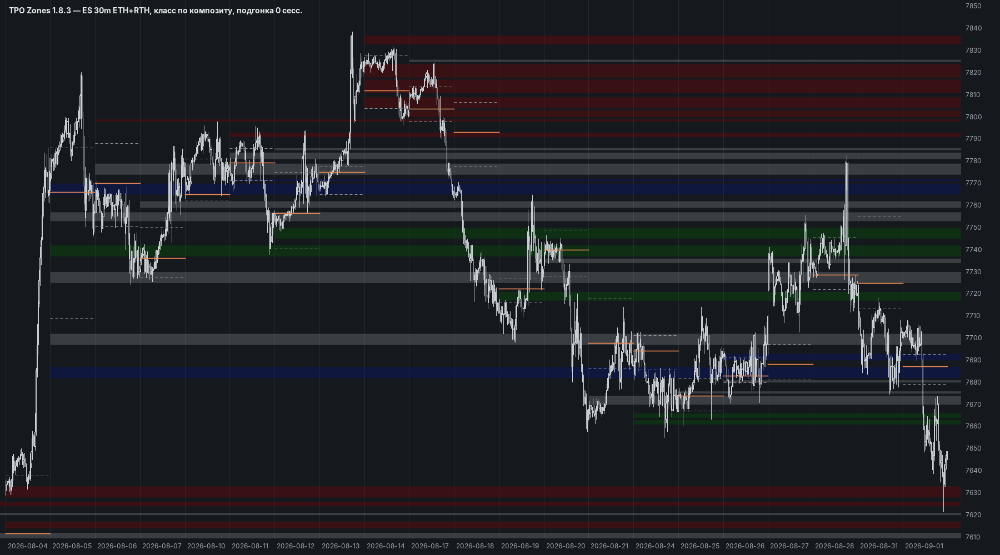
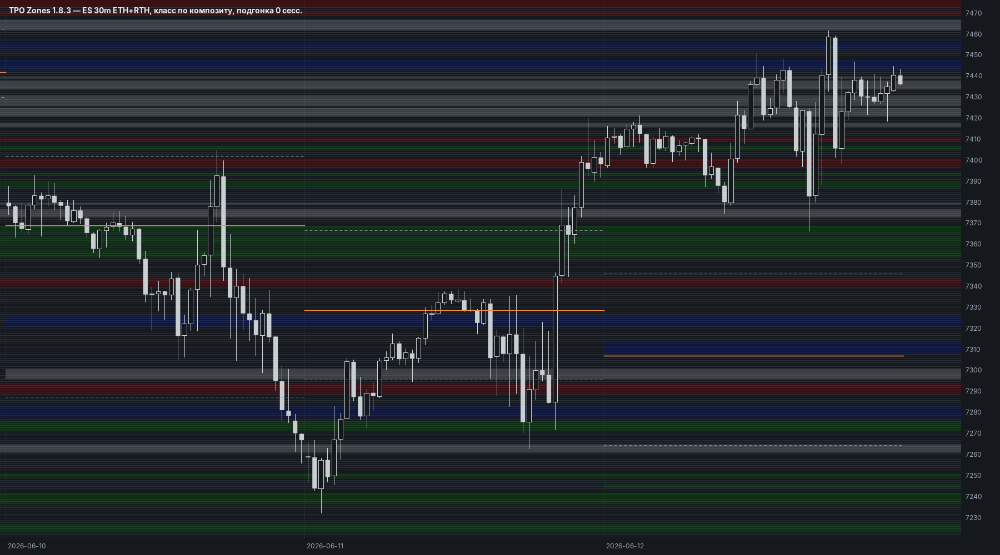

# TPO Zones 1.8.2 — индикатор для MotiveWave 7

Плотная карта зон ES прямо на графике MotiveWave: тонкие зоны из TPO-профилей каждой сессии, цвет — по
балансу (композиту), в котором зона стоит, серые — минорная и сомнительная структура; поверх — зоны экстремумов:
поддержка на лоях и сопротивление на хаях у краёв балансов.

**Версия 1.8.2 (19.11.2026, ветка `zones-1.8.2`, `dist/TpoZones-1.8.2.jar`)** — 1.8 + три изменения:
- **пороги в волатильности** (раздел 7): ядро композита, ширина зоны и предел ложного выхода — от среднего диапазона дня;
- **зоны экстремумов** (раздел 8): поддержка на лоях и сопротивление на хаях у краёв балансов — то, что зоны проторговки
  не видят по построению;
- **настройки — только вид** (раздел «Настройки»): все пороги алгоритма зашиты в коде (`ZoneEngine.Params`).

Из 1.8.1: свой пакет классов в jar (версии не подменяют друг друга после перезапуска MotiveWave), версия и сборка в
строке info. Здесь — как индикатор устроен. С чего начинать следующую версию — [`HANDOFF.md`](HANDOFF.md).

- Что и почему согласовано с автором разметки, что пробовали и отвергли, как работать дальше — [`HANDOFF.md`](HANDOFF.md).
- Как индикатор менялся с 1.1, с цифрами каждого шага — [`HISTORY.md`](HISTORY.md).


## Установка

1. Закрыть MotiveWave и удалить из папки расширений прежние `TpoZones-*.jar` (1.7, 1.8, 1.8.1 и копии вида
   `TpoZones-1.8 (1).jar`). Папка — обычно `MotiveWave Extensions` в домашней папке; найти все копии (PowerShell):
   `Get-ChildItem -Path $env:USERPROFILE -Recurse -Filter "TpoZones*.jar" -ErrorAction SilentlyContinue`.
2. Запустить MotiveWave: **Import Studies/Strategies…** → `dist/TpoZones-1.8.2.jar`.
3. На графике ES (30m или любой другой таймфрейм): меню исследований → **Patterns → TPO Zones 1.8.2**; старые
   «TPO Zones 1.8 / 1.8.1» с графика убрать.

Индикатор сам запрашивает 30m-серию («Расчёт → Бары профиля», не менять) и историю за 1500 календарных дней.
MotiveWave хранит настройки индикатора, стоящего на графике: новые значения по умолчанию из нового jar не
подхватываются — индикатор нужно убрать с графика и добавить заново. id — `TPO_ZONES_1_8_2`.

**Почему «откатывалась» версия (до 1.8.1).** У всех jar до 1.8 включительно одни и те же классы
(`patterns.zones.TpoZonesStudy` и др.). Если в расширениях лежат два таких jar, Java берёт класс из того, что
загрузился первым: сразу после импорта работает новая сборка, после перезапуска — снова старая. С 1.8.1 классы в jar
лежат в пакете своей версии (`patterns.zones.v1_8_1`), поэтому jar разных версий друг друга не подменяют. Какая сборка
загружена, видно в строке info индикатора: «TPO Zones 1.8.2 (сборка 2026-11-19 <коммит>): RTH-дней …».

## Принцип действия

Всё считается по 30m-барам серии, в ценах графика. Зона появляется на следующий торговый день после сессии,
из которой родилась, и дальше идёт ровно вправо до края графика. Пересчёт — раз в сессию, на первом баре
новой сессии.

### 1. Сессии и роллы

- **RTH-день** — бары 08:30–15:00 CT (13 периодов; короче — короткий день). **Сессия** — Globex с 17:00
  предыдущего дня до 16:00: тела её свечей (ETH + RTH) нужны для подгонки зон.
- **Роллы.** Ряд MotiveWave (ESZ6) не склеен: на смене контракта (понедельник перед неделей экспирации,
  15:00 CT) цена прыгает на спред, 49–74 п. Движок находит ролл — самый большой скачок между соседними 30m-барами
  в 10 днях до 3-й пятницы мар / июн / сен / дек, не меньше 20 п. — но **цены не сдвигает**: гэп настоящий, он
  сдвигает график, а с ним и новые зоны, и со старыми они не пересекаются. Ролл только рвёт композит.

### 2. Композиты (балансы)

TPO-профиль дня — в тиках, POC, Value Area 70% по Далтону. RTH-дни идут по порядку (короткие тоже) и
собираются в кандидата:

- день входит, если **close в диапазоне кандидата И наслоение VA** (VA дня и кандидата — или VA предыдущего
  дня кандидата — пересекаются на ≥ 50% меньшей);
- **внутренний день** (High–Low дня на ≥ 80% внутри диапазона кандидата) и **внешний** (диапазон кандидата на
  ≥ 80% внутри дня) входят по **ИЛИ**;
- иначе кандидат закрывается, день открывает новый; **ролл** тоже закрывает кандидата;
- **ложный выход:** пока новый кандидат не набрал 3 дней, день, закрывшийся обратно в диапазоне только что
  закрытого композита (не шире 100 п.) с наслоением VA, доклеивает дни к нему (не больше 2 раз подряд).

Кандидат от 3 дней — композит. **Ядро** — от POC вверх и вниз до обрыва TPO (строка на 4 принта ниже
максимума предыдущего пункта), не ниже 70% максимума, не шире 10 п. Композит — **баланс**, если ядро задевают
VA хотя бы половины его дней; иначе не используется. **Тело** — строки профиля не ниже 15% максимума (без
хвостов). Композит, чей диапазон на ≥ 70% внутри более раннего баланса (не шире его вдвое), — **уточнение**:
своего баланса не даёт, ценой управляет родитель. **Формирующийся** композит с 3-го полного дня уже задаёт
роли — снимок по прошедшим дням, со следующей сессии.



### 3. Сессионные зоны

Из каждого полного RTH-дня:

1. **Узлы профиля.** Сглаженный (1 п.) профиль делится по провалам (≥ 15% меньшей вершины). Узел — вершина
   не ниже 25% главного узла дня и от 3 TPO; слабее (от 2 TPO) — **минорный**.
2. **Мнимая зона** — строки узла не ниже 70% его вершины, ± 1 п. Она не рисуется.
3. **Скопления тел.** Внутри мнимой зоны — профиль тел 30m-свечей сессии. Каждое скопление (вершина ≥ 50%
   максимума и от 2 тел, разделены провалами) — отдельная зона: строки, где тел не меньше половины вершины.
   Ширина 1–4 п.
4. **Квадраты TPO** (на графике — `tickInterval 4`, квадрат 1 п.). Каждый край зоны встаёт на ближайшую границу
   квадрата; край посередине квадрата — наружу: квадрат с принтами не режется (принт в приоритете).
   Скопление уже квадрата — зона ровно в один квадрат.
5. **Первая зона на уровне — главная.** Узел, который пересекает существующую зону или стоит ближе 0.5 п., —
   её подтверждение, новой зоны нет; значит, между зонами минимум один пустой квадрат. Минорная зона —
   там, где нет других; сильный узел позже на её месте продолжает её обычной зоной.



### 4. Цвет

Зону красит композит, в тело которого попадает её середина: последний баланс или формирующийся композит,
доступный к её появлению.

| Цвет | Когда |
|---|---|
| синяя `#00158B` | зона задевает ядро композита |
| красная `#8B0000` | выше середины ядра |
| зелёная `#006400` | ниже середины ядра |

Если ядро баланса не задевает ни одна его зона, **синей становится ближайшая к ядру** — реальная зона, а не
нарисованное ядро (июнь 2024: ядро 5531–5532.25, синяя 5533–5537 из узла 21.06).

Зону синхронизирует **один** композит — первый, накрывший её (или формирующийся, в котором она родилась):
пока он формируется, цвет пересчитывается с каждым снимком, после закрытия заморожен. Более поздний композит
старую зону не перекрашивает. Зона **вне композитов** — по отторжениям в сессию рождения (хвост через границу
и close за зоной: вверх — зелёная, вниз — красная), при равенстве — по закрытию сессии (выше зоны — зелёная,
ниже — красная, внутри — серая).

**Первичный композит** — сложился в зоне price discovery: не меньше 30% его диапазона за пределами всех прежних
цен (выше прежнего максимума или ниже минимума, бары до его первого дня). Ничего, кроме него, там нет, поэтому его
зоны красятся **только по положению к его ядру** (у ядра синяя, выше красная, ниже зелёная), и правила серых ниже на
них не действуют; минорные остаются серыми. **Вторичный** композит (цена там уже была) — по общим правилам. Июль 2024
(09–17.07, ралли на хаи) и баланс 18.06–02.07.2024 — первичные; август 2024 у 5200–5370 и 20–26.08.2026 — вторичные.

**Синхронизация с профилем композита.** Профиль композита (все его дни) делится на узлы — горбы, разделённые
провалами ≥ 15% меньшей вершины; узел — строки не ниже 75% вершины. В каждом узле **истинная** — одна сессионная зона:
синяя у ядра, а если её нет — та, что стоит на самом проторгованном по профилю композита месте (при равенстве —
старшая). Остальные зоны в узле и зоны в провалах между узлами — **минорные, серые**. Плюс у краёв value area композита
по одной **главной** зоне **снаружи VA** (цена торгуется от них, баланс — над поддержкой и под сопротивлением):
поддержка — ближайшая к VAL снизу, сопротивление — ближайшая к VAH сверху (заходит внутрь VA не больше 1 п.); они
зелёная и красная, даже если были серыми. Решение — по последней сессии, на всю длину зоны.
Июнь 2024 (18.06–02.07): узлы — ядро 5528–5537.5 и 5561.25–5564.5; истинные — синяя 5533–5537 и красная 5561–5563;
главные — поддержка 5523–5524 у VAL 5523.75, сопротивление 5555–5557 над VAH 5552.5.

### 5. Серые

Правила по порядку (каждое видит цвета после предыдущего); справа — сколько серых даёт правило в последней сессии:

| # | Серая | Правило | Серых |
|---|---|---|---|
| 1 | минорная | слабый узел сессии — до прихода сильного узла на её место | 16 |
| 2 | роль не определилась | зона вне композитов: отторжений сверху и снизу поровну, сессия закрылась внутри зоны | 4 |
| 3 | колеблющаяся | в днях своего композита ≥ 2 отторжений, а перевес за её цвет (красная — снизу, зелёная — сверху) меньше 2:1; не тестировалась — цвет остаётся | 55 |
| 4 | стык | зелёная стоит сразу над красной (без серых и синих между, щель ≤ 3 п.) — обе: роли разных композитов противоречат друг другу | 42 |
| — | (первичный композит) | его зоны перекрашиваются по ядру — серость 3–4 с них снимается, минорные остаются | |
| 5 | минорная в композите | синхронизация с профилем композита: не истинная в своём узле или стоит в провале между узлами | 275 |

Узкие зоны серыми **не** делаются: правила «скопление уже квадрата — серое» и «узкая ≤ 2 п. — серая» выключены по
умолчанию (галочки остались; внутри композитов узкие всё равно разбирает синхронизация).

### 6. Раскладка и рисование

- В каждой сессии зоны не налезают: синие первыми, затем остальные от старших к младшим, серые последними;
  младшая, налезающая на уложенную, не рисуется.
- **Одна зона на ценовом уровне графика:** младшая, которая налезает на старшую или ближе 0.5 п. к ней,
  сужается до самого широкого свободного куска (по квадратам), уже 1 п. — не рисуется.
- Зона — **одна полоса одного цвета** по всей длине: цвет и границы на последнюю сессию, где она видна.
- Зоны, дошедшие до последней сессии, рисуются ещё на **7 дней вправо** — за последнюю свечу.
- Заливка 30%, без линий границ. Пунктир / оранжевая — VAH, VAL / POC вчерашнего RTH-профиля на каждую сессию.
- Зоны экстремумов — своим слоем поверх остальных (раскладка «одна зона на уровне» их не касается): заливка 45% и
  обводка, от сессии появления до бара пробоя.
- Подсказка при наведении: вид, границы, дата появления, возраст, отторжения, композит и его ядро, почему серая; у зоны
  экстремума — хай / лой и сессия, на сколько ушли, подтверждения, пробита ли.

### 7. Пороги в волатильности (1.8.2)

Средний RTH-день ES гуляет от 41 п. (2023) до 70 п. (2022), в 2026 — 64 п. Три порога в пунктах умножаются на
«средний диапазон 20 прошлых полных RTH-дней / 54.5 п.» (54.5 — медиана дня 2024–2026, где настраивалась 1.8):
- ядро композита ≤ 10 п. — по дням композита;
- сессионная зона ≤ 4 п. — по дню, из которого она родилась;
- ложный выход: диапазон закрытого композита ≤ 100 п. — по его дням.

Квадрат TPO (1 п.), зазор 0.5 п. и прочие пороги в пунктах — сетка графика, не масштабируются. В спокойные годы зоны
уже, в бурные шире (ширины 1–7 п. вместо горба на 4 п.); у ручной разметки так же: в 2024 медиана 2 п., в 2026 — 5 п.

### 8. Зоны экстремумов (1.8.2)

Зоны проторговки (разделы 3–5) берутся там, где цена торговалась; на хаях и лоях баланса цену быстро отбрасывали —
хвосты, мало TPO, узла нет, и зоны там не было (июнь 2024: лои 24.06 / 01.07 и хай 20.06 — у ручной разметки есть,
у 1.8 нет; из 64 ручных зон, которых 1.8 не находит, разворотов цены у 62% против 41% у сдвинутых). Зона экстремума:

1. **Экстремум** — хай (и отдельно лой) Globex-сессии (ETH + RTH).
2. **Края по телам:** свечи 30m, дотянувшиеся до верхних 15% диапазона сессии (1.5–5 п.): верх зоны — медиана их хаёв,
   низ — медиана верхних краёв их тел (у лоя зеркально); ширина 1–4 п. («тень — где встретили игрока, края по телам»).
3. **Отторжение:** зона появляется со следующей сессии после того, как цена ушла от экстремума на max(8 п., 25% среднего
   диапазона 20 прошлых сессий) раньше, чем два close подряд за зоной — в той же сессии или позже (лой 24.06.2024
   отыграли на следующий день). Без заглядывания вперёд.
4. **Живёт** до пробоя: два close 30m подряд за зоной — рисуется до этого бара и обрывается.
5. **Только края балансов:** поддержка — не выше VAL своего баланса (+ 1 п.), сопротивление — не ниже VAH (− 1 п.);
   «свой» — последний баланс, известный к появлению зоны (закрытый или формирующийся), чей диапазон её накрывает; вне
   балансов — всегда. Экстремумы сессий внутри value — ротация, не край (фильтр убирает 60% кандидатов).
6. **Подтверждение:** экстремум ближе 1 п. к живой зоне той же стороны — её подтверждение (в подсказке), новой зоны нет.

Цвет — по роли: поддержка экстремума зелёная, сопротивление красная, ярче обычных и с обводкой.

## Настройки

С 1.8.2 все пороги алгоритма зашиты в коде — значения по умолчанию `ZoneEngine.Params` (каждое с комментарием); индикатор
сам ставит `compositeMode = true`, `zoneMaxWidthPts = 10`, тик — из инструмента, история — 1500 календарных дней.
В настройках одна вкладка **«Вид»**:

| Группа | Что |
|---|---|
| Цвета зон | синяя (проторговка), красная, зелёная, серая, сопротивление экстремума, поддержка экстремума |
| Показывать | серые зоны; зоны экстремумов; вчера VAH / VAL / POC |
| Заливка, % | зоны 30, серые 30, зоны экстремумов 45 |
| Вчерашний профиль | цвет VAH / VAL, цвет POC |
| Данные | бары профиля — 30 мин, не менять (индикатор по ним считает на любом таймфрейме графика) |

Поменять порог — правка `Params` в `ZoneEngine.java` и новая сборка; в инструментах `parity/` — `поле=значение`
(`volScale=false`, `extremes=false` — как 1.8).

## Цифры 1.8.2 (последняя сессия 12.11.2026; сырые бары ESZ6, история как в MotiveWave — с 10.10.2022)

| | 1.8 | 1.8.2 |
|---|---|---|
| зон проторговки на графике | 732; в ± 150 п. от цены 56 | 734; в ± 150 п. от цены 54 |
| виды | серых 392, зелёных 133, синих 110, красных 97 | серых 397, зелёных 132, синих 111, красных 94 |
| ширина | 1 п. 20%, 2 п. 17%, 3 п. 12%, 4 п. 43%, 5 п. 9% | 1 п. 20%, 2 п. 17%, 3 п. 28%, 4 п. 20%, 5–7 п. 15% |
| зоны экстремумов | — | 514 за историю; живых в последнюю сессию 50 (поддержек 44), в ± 150 п. от цены 1 |
| пересечения / разрывы / обрывы до края | 0 / 0 / 0 | 0 / 0 / 0 (зоны экстремумов — слой поверх) |
| против 111 ручных зон (`Bench`) | найдено 42%, IoU ≥ 0.5 19%, ошибка края 1.52 п., цвет 17% | найдено 45%, IoU ≥ 0.5 22%, ошибка края 1.36 п., цвет 22% |

Только пороги в волатильности (без зон экстремумов): найдено 41%, IoU ≥ 0.5 18%, ошибка края 1.46 п., цвет 20%.
«Цвет совпал» шумный: ± 2–3 п.п. — это 2–3 зоны из 111.

## Как мерить

```bash
python -m motivewave.parity.export_bars /tmp/bars_raw.csv --raw     # бары как в MotiveWave (несклеенные)
python -m scripts.manual_zones                                       # ручные зоны → output/manual_zones_bench_raw.csv
javac -encoding UTF-8 -d /tmp/cls motivewave/src/patterns/zones/ZoneEngine.java motivewave/src/patterns/zones/ZonePlan.java \
  motivewave/parity/*.java
java -cp /tmp/cls Bench /tmp/bars_raw.csv output/manual_zones_bench_raw.csv [поле=значение ...]
java -Djava.awt.headless=true -cp /tmp/cls Preview /tmp/bars_raw.csv out.png 12 0 0 comp 2024-07-03 [поле=значение ...]
java -cp /tmp/cls Dump /tmp/bars_raw.csv dump.txt [поле=значение ...]
java -cp /tmp/cls patterns.zones.Check /tmp/bars_raw.csv [поле=значение ...]
motivewave/parity/previews.sh                                        # все картинки img/ и замер
```

- Без `поле=значение` инструменты считают **как индикатор по умолчанию**; поля — `ZoneEngine.Params`
  (например `rollRaw=false`, `invertGrey=false`, `compSync=false`; `volScale=false extremes=false` — как 1.8, дамп
  побайтно тот же).
- **История.** MotiveWave грузит историю на 1500 календарных дней назад **от сегодняшней даты** (и в реплее), а
  `bars_raw.csv` начинается с 12.2020. Набор зон зависит от начала истории (старые зоны, подтверждения), поэтому для
  сверки со скринами из MotiveWave — `-Dfrom=YYYY-MM-DD` (сегодня минус 1500 дней); `-Dto=YYYY-MM-DD` — данные по дату
  (как в реплее). Работает во всех инструментах; `previews.sh` ставит `-Dfrom` сам.
- **Check** — сводка на последнюю сессию: виды, почему серые (по правилу), ширины, плотность у цены, пересечения
  прямоугольников, разрывы и обрывы зон; зоны экстремумов (всего, живых, у цены).
- **Bench** — для каждой ручной зоны лучшая по IoU зона алгоритма (с 1.8.2 — и зона экстремума) в 10 сессий от её начала: найдено (IoU ≥ 0.3 /
  ≥ 0.5), ошибка краёв, совпадение цвета, плотность у цены. «Цвет совпал» шумный: ± 2–3 п.п. — это 2–3 зоны.
- **Preview** — картинка того, что рисует индикатор: `[сессий] [подгонка] [топ] [comp|rej] [последний день]`;
  `-Dmanual=output/manual_zones_bench_raw.csv` — ручные зоны пунктиром, `-Dgrid=true` — сетка квадратов.
- Разбор отдельного места: `patterns.zones.CompView bars out.png from to` — композиты рамками поверх баров;
  `patterns.zones.ProfView bars out.png from to дата_данных lo hi` — профили RTH-дней, как их видит алгоритм (узлы →
  зоны или подтверждения, цвет); `patterns.zones.NodesView bars out.png дата_данных начало_композита` — профиль
  композита, его узлы, VAL / VAH и зоны: истинные, минорные, главные.
- **ZoneSnap** — зоны на каждый RTH-день так, как их видит индикатор к открытию RTH (данные строго до 08:30 CT,
  история `-Dhist` дней): `java -cp /tmp/cls patterns.zones.ZoneSnap bars с_даты по_дату` → CSV для `scripts/zones18_mp.py`.
- **Dump** — всё, что рисует движок (зоны по сессиям, прямоугольники, уровни, подсказки), в текст: эталон до
  правки и сверка после (`cmp`). Для правки «без изменения поведения» — сравнить дампы.


`motivewave/parity/run.sh` — сверка прежнего режима 1.1 с Python (`scripts/zone_map_export.py`) и JS страницы карты
зон на склеенных барах (нужен node).

## Устройство кода

| Файл | Что |
|---|---|
| `src/patterns/zones/ZoneEngine.java` | весь расчёт, без SDK: роллы, дни и профили, композиты, сессионные зоны, роли, состояние зоны на сессию, раскладка, серые. Все пороги — `ZoneEngine.Params` с комментариями |
| `src/patterns/zones/ZonePlan.java` | что рисовать: прямоугольники зон и уровни вчерашнего профиля, подсказки (без SDK) |
| `src/patterns/zones/TpoZonesStudy.java` | обёртка SDK: настройки (ключ / подпись / значение по умолчанию) и фигуры |
| `parity/` | `export_bars.py`, `Bench`, `Preview`, `Dump`, `Check`, `previews.sh`; разбор: `CompView` (композиты поверх баров), `ProfView` (профили дней: узлы → зоны), `NodesView` (профиль композита, узлы, VA, истинные / минорные / главные); сверка 1.1 с Python: `ParityDump`, `compare.py`, `vis_from_page.js`, `run.sh` |
| `sdk-stubs/` | заглушки классов SDK для сборки без MotiveWave |
| `img/` | картинки этого README (`parity/previews.sh`) |

Значение настройки по умолчанию задаётся **в двух местах**: поле `Params` и `TpoZonesStudy` (descriptor +
`getXxx(KEY, def)`); индикатор сам ставит `compositeMode = true`, `zoneMaxWidthPts = 10` — так же делают
`Bench`, `Preview`, `Dump`.

## Сборка

```bash
motivewave/build.sh                                                   # против sdk-stubs/, хватает JDK 21
JAVAC=/путь/к/jdk-24+/bin/javac MW_SDK=/путь/к/mwave_sdk.jar motivewave/build.sh   # с настоящим SDK
```

Версия — переменная `VERSION` в `build.sh` (и `VERSION`, id, имя в `TpoZonesStudy`). В репозитории код в пакете
`patterns.zones` (его используют инструменты `parity/`); `build.sh` собирает копию исходников с пакетом
`patterns.zones.v<версия>` и подставляет в `TpoZonesStudy.BUILD` дату и коммит (`-dirty`, если в `motivewave/` есть
незакоммиченные правки) — jar собирать после коммита исходников.

SDK MotiveWave 7 (`mwave_sdk.jar`, сборка 2025-09-19) скомпилирован под Java 24, поэтому с ним нужен javac 24+.
Байткод индикатора — Java 21. SDK в репозиторий не кладётся (`lib/` в `.gitignore`).

`sdk-stubs/` — заглушки тех классов и методов SDK, которые вызывает индикатор. Сигнатуры сняты с
`TpoZonesStudy.class` из jar 1.7, собранного настоящим SDK: исходники 1.7 против заглушек дают побайтно тот же класс.
В jar заглушки не попадают. Проверка после сборки — вызовы SDK в новом классе (с 1.8.1 —
`patterns/zones/v1_8_1/TpoZonesStudy.class` в jar) те же, что в выпущенном 1.7:

```bash
javap -c -p <класс> | grep -oE "// (Interface)?Method com/motivewave[^ ]+" | sort -u    # эталон — jar из коммита 0482271
```

Новый вызов SDK — добавить его в заглушки с той же сигнатурой и один раз собрать с настоящим SDK.
