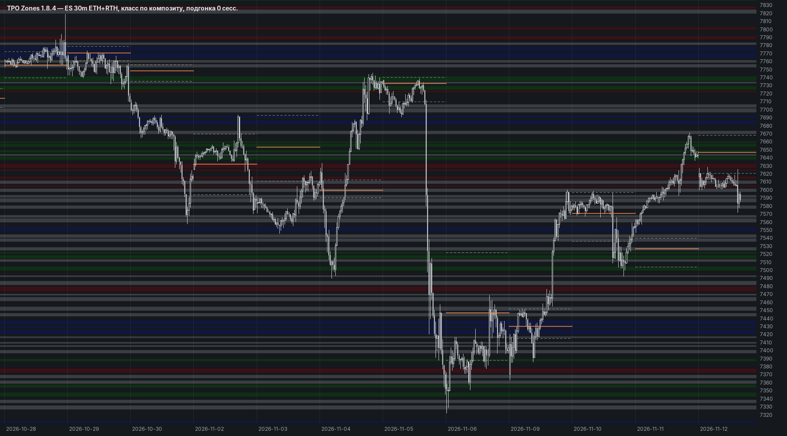
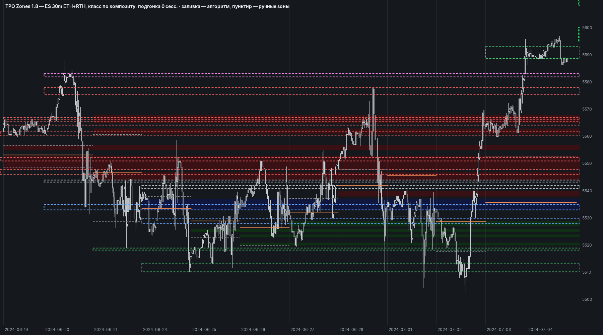

# TPO Zones 1.8 — индикатор для MotiveWave 7

Плотная карта зон ES прямо на графике MotiveWave: тонкие зоны из TPO-профилей каждой сессии, цвет — по
балансу (композиту), в котором зона стоит, серые — минорная и сомнительная структура.

- Что и почему согласовано с автором разметки, что пробовали и отвергли, как работать дальше — [`HANDOFF.md`](HANDOFF.md).
- Как индикатор менялся с 1.1, с цифрами каждого шага — [`HISTORY.md`](HISTORY.md).



## Установка

1. Взять `dist/TpoZones-1.8.jar`.
2. В MotiveWave: **Import Studies/Strategies…** → выбрать jar.
3. На графике ES (30m или любой другой таймфрейм): меню исследований → **Patterns → TPO Zones 1.8**.

Индикатор сам запрашивает 30m-серию («Расчёт → Бары профиля», не менять) и историю за 1500 календарных дней.
MotiveWave хранит настройки индикатора, стоящего на графике: новые значения по умолчанию из нового jar не
подхватываются — индикатор нужно убрать с графика и добавить заново. id — `TPO_ZONES_1_8`; jar предыдущей
версии из расширений MotiveWave удалить (классы в jar одни и те же).

## Принцип действия

Всё считается по 30m-барам серии, в ценах графика. Зона появляется на следующий торговый день после сессии,
из которой родилась, и дальше идёт ровно вправо до края графика. Пересчёт — раз в сессию, на первом баре
новой сессии.

### 1. Сессии и роллы

- **RTH-день** — бары 08:30–15:00 CT (13 периодов; короче — короткий день). **Сессия** — Globex с 17:00
  предыдущего дня до 16:00: тела её свечей (ETH + RTH) нужны для подгонки зон.
- **Роллы.** Ряд MotiveWave (ESZ6) не склеен: на смене контракта (понедельник перед неделей экспирации,
  15:00 CT) цена прыгает на спред, 49–74 п. Движок находит ролл — самый большой скачок между соседними 30m-барами
  в 10 днях до 3-й пятницы мар / июн / сен / дек, не меньше 20 п. — но **цены не сдвигает**: гэп настоящий, он
  сдвигает график, а с ним и новые зоны, и со старыми они не пересекаются. Ролл только рвёт композит.

### 2. Композиты (балансы)

TPO-профиль дня — в тиках, POC, Value Area 70% по Далтону. RTH-дни идут по порядку (короткие тоже) и
собираются в кандидата:

- день входит, если **close в диапазоне кандидата И наслоение VA** (VA дня и кандидата — или VA предыдущего
  дня кандидата — пересекаются на ≥ 50% меньшей);
- **внутренний день** (High–Low дня на ≥ 80% внутри диапазона кандидата) и **внешний** (диапазон кандидата на
  ≥ 80% внутри дня) входят по **ИЛИ**;
- иначе кандидат закрывается, день открывает новый; **ролл** тоже закрывает кандидата;
- **ложный выход:** пока новый кандидат не набрал 3 дней, день, закрывшийся обратно в диапазоне только что
  закрытого композита (не шире 100 п.) с наслоением VA, доклеивает дни к нему (не больше 2 раз подряд).

Кандидат от 3 дней — композит. **Ядро** — от POC вверх и вниз до обрыва TPO (строка на 4 принта ниже
максимума предыдущего пункта), не ниже 70% максимума, не шире 10 п. Композит — **баланс**, если ядро задевают
VA хотя бы половины его дней; иначе не используется. **Тело** — строки профиля не ниже 15% максимума (без
хвостов). Композит, чей диапазон на ≥ 70% внутри более раннего баланса (не шире его вдвое), — **уточнение**:
своего баланса не даёт, ценой управляет родитель. **Формирующийся** композит с 3-го полного дня уже задаёт
роли — снимок по прошедшим дням, со следующей сессии.


### 3. Сессионные зоны

Из каждого полного RTH-дня:

1. **Узлы профиля.** Сглаженный (1 п.) профиль делится по провалам (≥ 15% меньшей вершины). Узел — вершина
   не ниже 25% главного узла дня и от 3 TPO; слабее (от 2 TPO) — **минорный**.
2. **Мнимая зона** — строки узла не ниже 70% его вершины, ± 1 п. Она не рисуется.
3. **Скопления тел.** Внутри мнимой зоны — профиль тел 30m-свечей сессии. Каждое скопление (вершина ≥ 50%
   максимума и от 2 тел, разделены провалами) — отдельная зона: строки, где тел не меньше половины вершины.
   Ширина 1–4 п.
4. **Квадраты TPO** (на графике — `tickInterval 4`, квадрат 1 п.). Каждый край зоны встаёт на ближайшую границу
   квадрата; край посередине квадрата — наружу: квадрат с принтами не режется (принт в приоритете).
   Скопление уже квадрата — зона ровно в один квадрат.
5. **Первая зона на уровне — главная.** Узел, который пересекает существующую зону или стоит ближе 0.5 п., —
   её подтверждение, новой зоны нет; значит, между зонами минимум один пустой квадрат. Минорная зона —
   там, где нет других; сильный узел позже на её месте продолжает её обычной зоной.


### 4. Цвет

Зону красит композит, в тело которого попадает её середина: последний баланс или формирующийся композит,
доступный к её появлению.

| Цвет | Когда |
|---|---|
| синяя `#00158B` | зона задевает ядро композита |
| красная `#8B0000` | выше середины ядра |
| зелёная `#006400` | ниже середины ядра |

Если ядро баланса не задевает ни одна его зона, **синей становится ближайшая к ядру** — реальная зона, а не
нарисованное ядро (июнь 2024: ядро 5531–5532.25, синяя 5533–5537 из узла 21.06).

Зону синхронизирует **один** композит — первый, накрывший её (или формирующийся, в котором она родилась):
пока он формируется, цвет пересчитывается с каждым снимком, после закрытия заморожен. Более поздний композит
старую зону не перекрашивает. Зона **вне композитов** — по отторжениям в сессию рождения (хвост через границу
и close за зоной: вверх — зелёная, вниз — красная), при равенстве — по закрытию сессии (выше зоны — зелёная,
ниже — красная, внутри — серая).

**Первичный композит** — сложился в зоне price discovery: не меньше 30% его диапазона за пределами всех прежних
цен (выше прежнего максимума или ниже минимума, бары до его первого дня). Ничего, кроме него, там нет, поэтому его
зоны красятся **только по положению к его ядру** (у ядра синяя, выше красная, ниже зелёная), и правила серых ниже на
них не действуют; минорные остаются серыми. **Вторичный** композит (цена там уже была) — по общим правилам. Июль 2024
(09–17.07, ралли на хаи) и баланс 18.06–02.07.2024 — первичные; август 2024 у 5200–5370 и 20–26.08.2026 — вторичные.

### 5. Серые

| Серая | Правило |
|---|---|
| минорная | слабый узел сессии (до прихода сильного узла на её место) |
| узкая | не шире 2 п. на графике; **синяя у ядра остаётся синей** |
| колеблющаяся | в днях своего композита ≥ 2 отторжений, а перевес за её цвет (красная — снизу, зелёная — сверху) меньше 2:1 |
| стык | зелёная стоит сразу над красной (без серых и синих между, щель ≤ 3 п.) — обе: роли разных композитов противоречат друг другу |

Не тестировавшаяся в своём композите зона цвет сохраняет. Порядок: колеблющиеся → узкие → стык; затем зоны первичных
композитов перекрашиваются по ядру.

### 6. Раскладка и рисование

- В каждой сессии зоны не налезают: синие первыми, затем остальные от старших к младшим, серые последними;
  младшая, налезающая на уложенную, не рисуется.
- **Одна зона на ценовом уровне графика:** младшая, которая налезает на старшую или ближе 0.5 п. к ней,
  сужается до самого широкого свободного куска (по квадратам), уже 1 п. — не рисуется.
- Зона — **одна полоса одного цвета** по всей длине: цвет и границы на последнюю сессию, где она видна.
- Зоны, дошедшие до последней сессии, рисуются ещё на **7 дней вправо** — за последнюю свечу.
- Заливка 30%, без линий границ. Пунктир / оранжевая — VAH, VAL / POC вчерашнего RTH-профиля на каждую сессию.
- Подсказка при наведении: вид, границы, дата появления, возраст, отторжения, композит и его ядро, почему серая.

## Настройки

Вкладка **«Зоны»** — по шагам выше; ключи настроек не менялись с 1.8, сохранённые значения подхватываются.

| Группа | Главное (по умолчанию) |
|---|---|
| Композиты | от 3 дней; close в диапазоне И наслоение VA 50% (с предыдущим днём); внутренний / внешний день 80% — ИЛИ; ложный выход; ролл рвёт; ядро ≤ 10 п.; тело 15%; уточнение 70%; формирующийся композит |
| Сессионные зоны | узел ≥ 25% главного и ≥ 3 TPO; уточнение (мнимая зона); не шире 4 п.; квадрат TPO 1 п. (сдвиг сетки 0); зазор 0.5 п.; минорные; продолжение минорной сильным узлом |
| Цвет и серые | синяя — только у ядра; ядро без зоны — синяя ближайшая; первичный композит (30% диапазона за прежними ценами) — по ядру, без серых; узкая ≤ 2 п. серая, кроме синей; колеблющиеся 2:1 от 2 отторжений; стык ≤ 3 п.; хвост от 2 тиков |
| На графике | раскладка в сессии; одна зона на уровне; одна полоса; 7 дней вправо; 250 последних сессий |

Вкладка **«Прежние режимы»** — класс по отторжениям (1.1), разметка тела композита (1.6), первородные HVN-зоны,
фильтры страницы карты зон: по умолчанию не влияют на рисунок. **«Вид»** — цвета, заливка, вчерашний профиль.
**«Расчёт»** — бары, история, роллы (галочка «расчёт в ценах графика»: снять — склейка, расчёт в ценах текущего
контракта), часовой пояс и часы сессий, тик, Value Area.

## Цифры (последняя сессия 12.11.2026, сырые бары ESZ6)

| | |
|---|---|
| зон на графике | 767; в ± 150 п. от цены — 56 (≈ 19 на 100 п.) |
| виды | серых 227 (30%), зелёных 223, красных 192, синих 125 |
| ширина | 1 п. — 19%, 2 п. — 18%, 3 п. — 12%, 4 п. — 42%, 5 п. — 9% |
| пересечения / разрывы / обрывы до края | 0 / 0 / 0 |
| против 111 ручных зон (`Bench`) | найдено (IoU ≥ 0.3) 42%, IoU ≥ 0.5 19%, ошибка края 1.52 п., цвет 26% |

Горб на 4 п. — предел ширины зоны: скопление шире режется до 4 п. вокруг середины. Ручные зоны шире 5 п.
(28% разметки) алгоритм не рисует.

## Как мерить

```bash
python -m motivewave.parity.export_bars /tmp/bars_raw.csv --raw     # бары как в MotiveWave (несклеенные)
python -m scripts.manual_zones                                       # ручные зоны → output/manual_zones_bench_raw.csv
javac -encoding UTF-8 -d /tmp/cls motivewave/src/patterns/zones/ZoneEngine.java motivewave/src/patterns/zones/ZonePlan.java \
  motivewave/parity/Bench.java motivewave/parity/Preview.java motivewave/parity/Dump.java
java -cp /tmp/cls Bench /tmp/bars_raw.csv output/manual_zones_bench_raw.csv [поле=значение ...]
java -Djava.awt.headless=true -cp /tmp/cls Preview /tmp/bars_raw.csv out.png 12 0 0 comp 2024-07-03 [поле=значение ...]
java -cp /tmp/cls Dump /tmp/bars_raw.csv dump.txt [поле=значение ...]
motivewave/parity/previews.sh                                        # все картинки img/ и замер
```

- Без `поле=значение` инструменты считают **как индикатор по умолчанию**; поля — `ZoneEngine.Params`
  (например `rollRaw=false`, `invertGrey=false`, `oneSquareMaxPts=1`).
- **Bench** — для каждой ручной зоны лучшая по IoU зона алгоритма в 10 сессий от её начала: найдено (IoU ≥ 0.3 /
  ≥ 0.5), ошибка краёв, совпадение цвета, плотность у цены. «Цвет совпал» шумный: ± 2–3 п.п. — это 2–3 зоны.
- **Preview** — картинка того, что рисует индикатор: `[сессий] [подгонка] [топ] [comp|rej] [последний день]`;
  `-Dmanual=output/manual_zones_bench_raw.csv` — ручные зоны пунктиром, `-Dgrid=true` — сетка квадратов.
- **Dump** — всё, что рисует движок (зоны по сессиям, прямоугольники, уровни, подсказки), в текст: эталон до
  правки и сверка после (`cmp`). Для правки «без изменения поведения» — сравнить дампы.



`motivewave/parity/run.sh` — сверка прежнего режима 1.1 с Python (`scripts/zone_map_export.py`) и JS страницы карты
зон на склеенных барах (нужен node).

## Устройство кода

| Файл | Что |
|---|---|
| `src/patterns/zones/ZoneEngine.java` | весь расчёт, без SDK: роллы, дни и профили, композиты, сессионные зоны, роли, состояние зоны на сессию, раскладка, серые. Все пороги — `ZoneEngine.Params` с комментариями |
| `src/patterns/zones/ZonePlan.java` | что рисовать: прямоугольники зон и уровни вчерашнего профиля, подсказки (без SDK) |
| `src/patterns/zones/TpoZonesStudy.java` | обёртка SDK: настройки (ключ / подпись / значение по умолчанию) и фигуры |
| `parity/` | `export_bars.py`, `Bench`, `Preview`, `Dump`, `previews.sh`; сверка 1.1 с Python: `ParityDump`, `compare.py`, `vis_from_page.js`, `run.sh` |
| `sdk-stubs/` | заглушки классов SDK для сборки без MotiveWave |
| `img/` | картинки этого README (`parity/previews.sh`) |

Значение настройки по умолчанию задаётся **в двух местах**: поле `Params` и `TpoZonesStudy` (descriptor +
`getXxx(KEY, def)`); индикатор сам ставит `compositeMode = true`, `zoneMaxWidthPts = 10` — так же делают
`Bench`, `Preview`, `Dump`.

## Сборка

```bash
motivewave/build.sh                                                   # против sdk-stubs/, хватает JDK 21
JAVAC=/путь/к/jdk-24+/bin/javac MW_SDK=/путь/к/mwave_sdk.jar motivewave/build.sh   # с настоящим SDK
```

SDK MotiveWave 7 (`mwave_sdk.jar`, сборка 2025-09-19) скомпилирован под Java 24, поэтому с ним нужен javac 24+.
Байткод индикатора — Java 21. SDK в репозиторий не кладётся (`lib/` в `.gitignore`).

`sdk-stubs/` — заглушки тех классов и методов SDK, которые вызывает индикатор. Сигнатуры сняты с
`TpoZonesStudy.class` из jar 1.7, собранного настоящим SDK: исходники 1.7 против заглушек дают побайтно тот же класс.
В jar заглушки не попадают. Проверка после сборки — вызовы SDK в новом классе те же, что в выпущенном 1.7:

```bash
javap -c -p <класс> | grep -oE "// (Interface)?Method com/motivewave[^ ]+" | sort -u    # эталон — jar из коммита 0482271
```

Новый вызов SDK — добавить его в заглушки с той же сигнатурой и один раз собрать с настоящим SDK.
